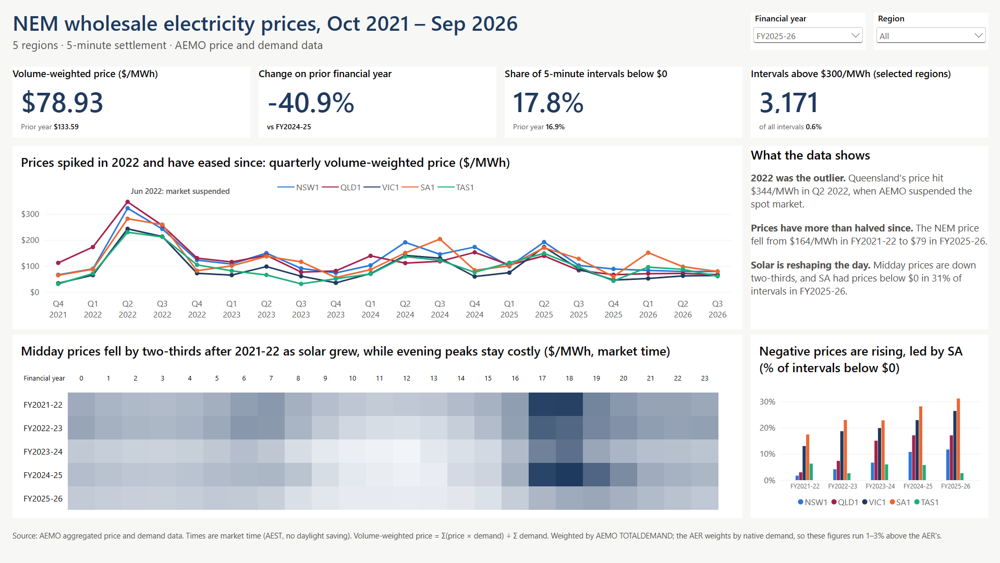

# NEM Wholesale Electricity Prices

**How have wholesale electricity prices moved across the NEM regions since 5-minute settlement started, and what drove the big moves?**

A one-page **Power BI** dashboard built from 2.6 million 5-minute price and demand records published by AEMO, covering all five NEM regions from October 2021 to September 2026. The data is combined in **Power Query**, modelled as a star schema, and measured with **DAX**. Every figure is checked against the Australian Energy Regulator's published statistics.



## Key findings

| # | Finding | Number | Where the AER says the same |
|---|---|---|---|
| 1 | **2022 was the outlier.** Prices peaked in Q2 2022, when AEMO suspended the spot market | Queensland **$344/MWh** in Q2 2022 (AER figure; $347 in this data) | AER [Wholesale markets quarterly Q2 2022](https://www.aer.gov.au/wholesale-markets/performance-reporting/wholesale-markets-quarterly-q2-2022), section 1.2, p. 2 |
| 2 | **Prices have more than halved since the 2022 peak** | NEM volume-weighted price **$164/MWh** in FY2021-22 → **$79** in FY2025-26 | AER [Wholesale electricity market performance report 2026](https://www.aer.gov.au/system/files/2026-08/Wholesale%20electricity%20market%20performance%20report%20-%202026.pdf) (WEMPR 2026), section 2.1, p. 14–15 |
| 3 | **Solar is reshaping the day.** Midday prices have fallen and negative prices are more common, led by South Australia | Midday (10:00–15:00) average **$87 → $28/MWh**; SA prices below $0 in **31%** of intervals in FY2025-26 | WEMPR 2026, section 2.1.1, p. 15 (negative prices "more frequent, mostly during the day, driven by new entry of solar and wind"); Figure 2.2, p. 16–17 |

**Read with care:** the AER's 2026 report uses calendar years, and it notes that 2025 prices were still above **2021** levels in every region except Queensland. The fall in finding 2 is measured from the 2022 crisis, not from before it.

**By financial year (all regions):**

| Financial year | Volume-weighted price ($/MWh) | Change on prior year | Intervals below $0 | Intervals above $300 |
|---|---|---|---|---|
| FY2021-22 (Oct–Jun) | 164.23 | – | 8.3% | 35,636 |
| FY2022-23 | 146.60 | −11% | 11.1% | 38,734 |
| FY2023-24 | 100.74 | −31% | 14.1% | 7,947 |
| FY2024-25 | 133.59 | +33% | 16.9% | 7,468 |
| FY2025-26 | 78.93 | −41% | 17.8% | 3,171 |

## How it works

```
AEMO (300 monthly CSVs)       Power Query                         Model                 Power BI
────────────────────────   ───────────────────────────────   ──────────────────   ─────────────────
5 regions × 60 months  ─▶   combine folder, type with         DimDate (FY, quarter)   1 page: 4 KPI cards,
5-minute RRP + demand       en-AU locale, shift to interval ─▶ DimRegion          ─▶ trend, heatmap,
2,629,440 rows              start, add Date and Hour          FactPrice, 11 DAX      negative-price chart
                                                              measures
```

| Step | Files |
|---|---|
| **1. Download:** 300 monthly files (5 regions × Oct 2021 – Sep 2026) from AEMO's aggregated price and demand data | [scripts/download_aemo.ps1](scripts/download_aemo.ps1) |
| **2. Clean (Power Query):** combine the folder; read `SETTLEMENTDATE` with the Australian locale; check every row is `TRADE`; move each timestamp back 5 minutes, because AEMO stamps the *end* of each interval, so the 00:00 interval belongs to the day before; add `Date` and `Hour` | [powerbi/nem_prices.pbix](powerbi/nem_prices.pbix) |
| **3. Model:** star schema with a DAX date table (financial year July–June, as the AER reports) and a region lookup | [powerbi/nem_prices.pbix](powerbi/nem_prices.pbix) |
| **4. Measure:** volume-weighted price, time-weighted price, negative-price share, intervals above $300, prior-year comparisons with `SAMEPERIODLASTYEAR` | [powerbi/measures.dax](powerbi/measures.dax) |
| **5. Validate:** a separate Python recount of the raw CSVs, and a comparison with the AER's published quarterly prices (below) | [scripts/check_totals.py](scripts/check_totals.py), [data/reference/](data/reference/) |
| **6. Present:** 1920 × 1080 page, one colour per region throughout | [powerbi/nem_prices.pdf](powerbi/nem_prices.pdf), [powerbi/nem_theme.json](powerbi/nem_theme.json) |

**The key measure:**

```DAX
Volume Weighted Price =
DIVIDE (
    SUMX ( FactPrice, FactPrice[RRP] * FactPrice[TOTALDEMAND] ),
    SUM ( FactPrice[TOTALDEMAND] )
)
```

Each 5-minute price is weighted by demand in that interval, so busy intervals count for more. This is the same method the AER uses.

## Validation

**Against the raw data.** A Python recount of all 300 CSVs ([scripts/check_totals.py](scripts/check_totals.py)) matches every DAX figure above exactly.
- **2,629,440 rows:** 1,826 days × 288 intervals × 5 regions, so no interval is missing.
- **No duplicates** on region and timestamp, and every row is a `TRADE` interval.

**Against the AER.** 95 region-quarters (Q4 2021 – Q2 2026) compared with the AER's published quarterly volume-weighted prices ([data/reference/](data/reference/)):

| Quarter | Region | This dashboard | AER | Difference |
|---|---|---|---|---|
| Q2 2022 | NSW | $322.77 | $321 | +0.6% |
| Q2 2022 | QLD | $347.33 | $344 | +1.0% |
| Q2 2022 | SA | $282.28 | $280 | +0.8% |
| Q2 2024 | NSW | $191.21 | $189 | +1.2% |
| Q2 2024 | SA | $150.43 | $148 | +1.6% |
| Q2 2026 | NSW | $79.10 | $78 | +1.4% |
| Q2 2026 | SA | $97.32 | $95 | +2.4% |

- **75 of 95 are within 3%,** and every quarter moves in the same direction as the AER's figures.
- **The gap is one-sided:** this dashboard is higher in 92 of the 95 quarters. It is largest in South Australia and Victoria, smallest in Tasmania, grows over time and peaks in spring. The largest is SA in Q4 2025: $59.07 against $54 (+9.4%).

**Why the gap: the two weight by different demand.**
- **This dashboard** weights by AEMO's `TOTALDEMAND`: demand met by scheduled and semi-scheduled generation.
- **The AER** weights by **native demand**, which adds non-scheduled generation: mostly small wind and solar farms connected to local networks (WEMPR 2026, note to Figure 2.1, p. 15). Neither measure includes rooftop solar.
- **The effect:** small solar farms produce most at midday, when prices are lowest. Counting their output gives cheap intervals more weight, so the AER's average is lower. That's also why the gap is biggest in the regions and seasons with the most solar.
- **Matching exactly** would need non-scheduled generation data from AEMO's market database, which isn't in the aggregated files. The AER also rounds to whole dollars.

## Limitations

- **Spot prices only.** Retailers and large users buy most electricity through contracts, so spot prices aren't what they pay.
- **Weighted by `TOTALDEMAND`, not native demand,** so prices run 1–3% above the AER's (see Validation).
- **Market time.** All times are AEST with no daylight saving, as AEMO publishes them. In summer, an hour on the heatmap is an hour behind clock time in NSW, VIC and TAS.
- **Part years.** FY2021-22 covers October–June only, because 5-minute settlement started on 1 October 2021. FY2026-27 (July–September only) is left out of the financial-year charts.
- **The data shows *what* happened, not *why*.** The causes in the findings are the AER's analysis, cited above.

## Tools

Power BI Desktop (Power Query M, DAX) · PowerShell · Python (validation) · Git

**To reproduce:**
1. Run `powershell -ExecutionPolicy Bypass -File scripts\download_aemo.ps1`. It downloads the 300 CSVs (about 120 MB) into `data/aemo_price_demand/`, which is git-ignored.
2. Open `powerbi/nem_prices.pbix`. If Power BI can't find the folder, update the path in **Transform data → FactPrice → Source**, then **Refresh**.
3. Optional: run `python scripts/check_totals.py data/aemo_price_demand` and compare its output with the financial-year table above.

## Data sources

- **Prices and demand:** [AEMO – Aggregated price and demand data](https://www.aemo.com.au/energy-systems/electricity/national-electricity-market-nem/data-nem/aggregated-data), NSW1, QLD1, VIC1, SA1 and TAS1, October 2021 – September 2026. Source: Australian Energy Market Operator.
- **Validation:** [AER – Wholesale statistics](https://www.aer.gov.au/wholesale-markets/wholesale-statistics), quarterly volume-weighted average spot prices by region. Source: Australian Energy Regulator.
- **Context:** AER [Wholesale electricity market performance report 2026](https://www.aer.gov.au/system/files/2026-08/Wholesale%20electricity%20market%20performance%20report%20-%202026.pdf) and [Wholesale markets quarterly Q2 2022](https://www.aer.gov.au/wholesale-markets/performance-reporting/wholesale-markets-quarterly-q2-2022).

---

*Dylan Kapadia · [LinkedIn](https://www.linkedin.com/in/dylan-kapadia/) · October 2026*
